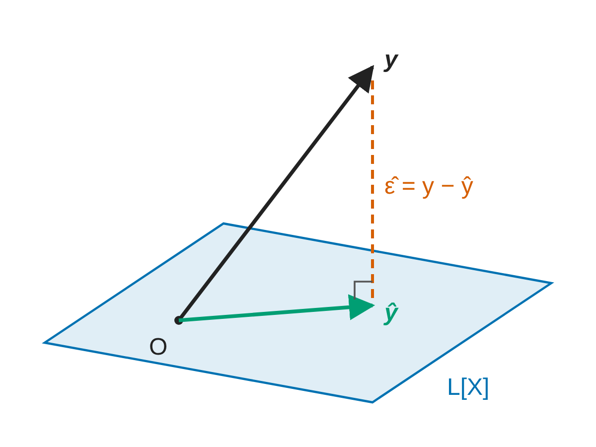

#+TITLE: 研究ノートの見本
#+SUBTITLE: Tufte 形式 (脚注・文献・補足の図が右の余白に)
#+AUTHOR: ox-quarto
#+DATE: 2026-11-10
#+STARTUP: content indent
#+OPTIONS: ^:{}
:QUARTO:
#+SETUPFILE: _quarto/org/note.org
#+BIBLIOGRAPHY: ../org/report-sample.bib
:END:

# 頭書きのメモ
# - _quarto/org/note.org (Tufte 形式．_quarto/yaml/note.yaml) を SETUPFILE にする．make は tools/notes.mk (このフォルダの Makefile)
# - org の目次 (#+OPTIONS: toc:2 など) は使わない (note.yaml の目次と二重になる)
# - 文献は引いた所の横の余白に書誌が出る．末尾の一覧は出ない (Quarto の citation-location: margin)

* 余白の注
本文は少し狭く，右の余白に脚注・文献・補足の図が並ぶ (Tufte 形式)．
原稿とコードを一つにまとめる考え方は文芸的プログラミング [cite:@Knuth_1984_LiterateProgramming] にさかのぼり[fn:lp]，
R Markdown [cite:@Xie_etal_2018_RMarkdownDefinitive] を経て Quarto に受け継がれている．
文献を引くと，その書誌が右の余白に出る．脚注も本文の下ではなく右の余白に出る．

#+begin_column-margin
#+attr_quarto: :width "100%"

補足の図: ~#+begin_column-margin~ の中に置いた図と文は右の余白に出る．
#+end_column-margin

* 図と表
#+name: fig-proj
#+caption: 図の説明は図の横の余白に出る
#+attr_quarto: :width "75%"

@fig-proj は本文の幅の図．本文より広くするなら ~#+ATTR_QUARTO: :class "column-page-right"~ と書く．

表の中の数式に絶対値を書くときは \(\lvert x\rvert\) と書く (~|~ は org の表の列の区切りになる)．

| 記号                 | 意味     |
|----------------------+----------|
| \(\lvert x\rvert\)   | 絶対値   |
| \(\lVert x\rVert_2\) | 2 ノルム |

[fn:lp] 脚注は右の余白に出る．本文の流れを止めずに補足を書ける．
