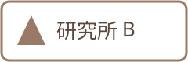

# acknowledgements.org — 謝辞の頁 (講演の org から #+INCLUDE で読み込む部品)
#
# 使い方: 講演の org の謝辞を置きたい所に
#   #+INCLUDE: "acknowledgements.org" :minlevel 2
# と書く (:minlevel 2 で下の * 謝辞 が ** の頁になる)．
# 出さないとき: その行を "# #+INCLUDE: …" とコメントにする (あるいは下の見出しを "* COMMENT 謝辞" にする)．
# 講演ごとに人や研究費が違うなら，このファイルを複製して ack-<講演>.org などにし，読み込む名前を変える．
#
# 書き方 (見た目は _quarto/scss/parts.scss，人の一覧の組み直しは _quarto/lib/ack.lua):
#   #+begin_people   人の一覧．記述リスト "- [[file:写真]] 名前 :: 所属"．写真は無くてもよい (円く切り抜く)
#   #+begin_funding  研究費．番号まで書く (例: JSPS 科研費 JP00X00000)
#   #+begin_logos    ロゴを 1 行に並べる (高さを揃える)．配布できないロゴは git に入れない
#   #+begin_ack-note 最後の小さな注記 (資料の作成に使った道具など)

* 謝辞
:PROPERTIES:
:QUARTO_ATTR: {.ack}
:END:
#+begin_people
-  山田 花子 :: ○○大学 理工学部
-  佐藤 太郎 :: △△研究所 データ科学部門
- 鈴木 一郎 :: □□大学 大学院 (写真を載せない例)
#+end_people

#+begin_funding
本研究は JSPS 科研費 JP00X00000 および ○○財団 研究助成の支援を受けた．
#+end_funding

#+begin_logos
 
#+end_logos

#+begin_ack-note
スライドと図の作成の一部に Claude (Anthropic) を用いた．内容の確認と責任は発表者にある．
#+end_ack-note

#+begin_notes
共同研究者と研究費への謝辞．人は所属とあわせて「名前 :: 所属」の形で揃えて書く．
#+end_notes
